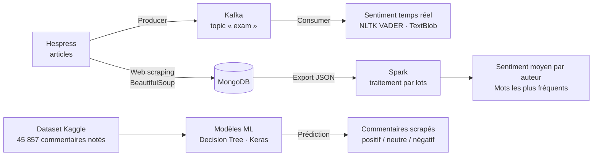

# Analyse de sentiments des commentaires Hespress — pipeline Big Data

Pipeline de bout en bout qui **collecte les commentaires des lecteurs de [Hespress](https://www.hespress.com)** (média marocain), les **diffuse en temps réel avec Kafka**, les **traite par lots avec Spark** et en **analyse le sentiment** (NLTK, TextBlob, scikit-learn, TensorFlow).


---

## Architecture



| Étape | Outil | Ce qui est fait |
|---|---|---|
| 1. Ingestion | `requests`, `BeautifulSoup`, `pymongo` | Scraping des commentaires d'un article et stockage dans MongoDB |
| 2. Streaming | `confluent_kafka` | Publication de chaque commentaire (auteur + texte) dans le topic Kafka `exam`, puis consommation |
| 3. Sentiment temps réel | NLTK (VADER), TextBlob | Score de chaque commentaire à la consommation |
| 4. Traitement par lots | PySpark | Regroupement par auteur, découpage en lots, sentiment moyen par auteur, fréquence des mots |
| 5. Modèle supervisé | scikit-learn, TensorFlow/Keras | Entraînement sur un dataset Kaggle de commentaires politiques Hespress, puis étiquetage des commentaires scrapés |

## Résultats

- **825 commentaires** collectés et traités par Spark en **11 lots** de 82.
- Analyse lexicale : *المغرب* (« le Maroc ») et *الله* figurent parmi les mots pleins les plus fréquents.
- Les commentaires scrapés sont étiquetés **positif / neutre / négatif** et exportés dans `scraped_data_with_sentiment.json`.

### Limites identifiées et pistes d'amélioration

- **VADER et TextBlob sont conçus pour l'anglais** : sur des commentaires en arabe, ils renvoient presque toujours un score neutre. Prochaine étape : un modèle arabe (ex. [CAMeLBERT](https://huggingface.co/CAMeL-Lab) ou AraBERT).
- Le Decision Tree est évalué sur ses propres données d'entraînement ; une évaluation sur un jeu de test séparé (train/test split) est à ajouter.
- Nettoyage du texte (mots vides arabes, ponctuation, retours à la ligne) avant le comptage des mots.
- Tableau de bord des résultats (Tableau / Power BI / Streamlit).

## Structure du dépôt

```
├── projet.bigdata.ipynb       # Pipeline : scraping → MongoDB → Kafka → Spark → sentiment
├── kaggledataset.ipynb        # Modèles supervisés (Decision Tree, Keras) sur le dataset Kaggle
├── comments.json              # 825 commentaires scrapés (export MongoDB)
├── comments_politique.csv     # Dataset Kaggle : 45 857 commentaires politiques notés
└── requirements.txt
```

## Lancer le projet

**Prérequis :** Python 3.9+, Java 8/11 (pour Spark), MongoDB et Kafka en local (`localhost:27017`, `localhost:9092`).

```bash
git clone https://github.com/saadmekraz/Hespress_Project.git
cd Hespress_Project
pip install -r requirements.txt

# Démarrer Kafka puis créer le topic
kafka-topics.sh --create --topic exam --bootstrap-server localhost:9092

jupyter notebook projet.bigdata.ipynb
```

> Dans les notebooks, remplacez le chemin `C:\Users\...\comments.json` par `comments.json`.

## Auteur

**Saad Mekraz** — [GitHub](https://github.com/saadmekraz)
